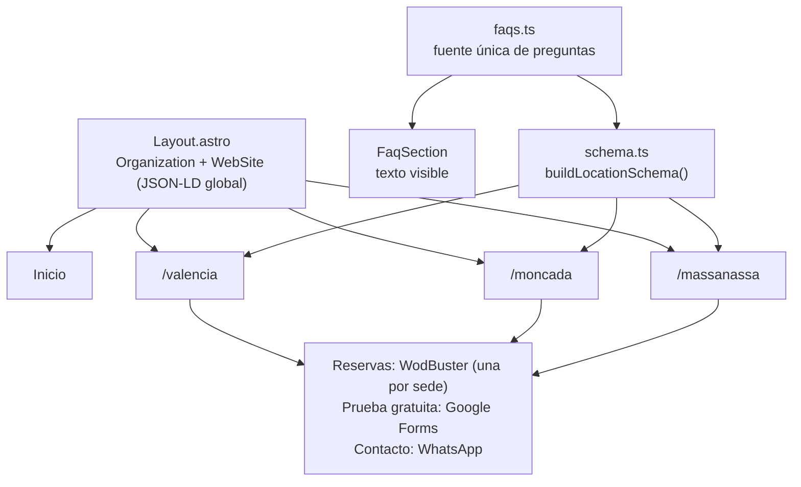

# Taronja Box — sitio web multisede

Sitio web de [Taronja Box](https://taronjabox.com), un box de CrossTraining con tres sedes (Valencia, Moncada y Massanassa), construido como sitio estático con Astro y Tailwind para un alojamiento básico, con una página, unos datos estructurados y unas preguntas frecuentes propias para cada sede. Está en producción en taronjabox.com y este repositorio es la copia publicable del código.

## Qué problema resuelve

Tres sedes de un mismo negocio compiten por las mismas búsquedas locales, y si todas compartieran una sola página, cada sede dependería de una única URL y de una única dirección en los datos del negocio. Por eso cada sede tiene la suya (`/valencia`, `/moncada`, `/massanassa`), con su dirección, su teléfono, sus coordenadas, su calendario de reservas y sus preguntas frecuentes, y entre ellas no hay redirecciones automáticas por ubicación: quien entra por la portada elige la sede.

## Cómo encaja



## Decisiones técnicas

| Decisión | Motivo | Consecuencia |
|---|---|---|
| **Sitio estático con Astro y Tailwind** | El alojamiento (Hostinger, servidor LiteSpeed) sirve HTML y no ejecuta código de servidor. | Nada se calcula por visita; lo que dependiera del visitante tendría que resolverse en su navegador. |
| **Una URL por sede, sin redirección por ubicación** | Cada sede necesita una dirección propia y estable. | La elección de sede la hace la persona desde la portada, no el sitio por ella. |
| **Datos estructurados generados, no escritos a mano** | `buildLocationSchema()` produce para cada sede un `ExerciseGym` y `LocalBusiness` con dirección y coordenadas, más un `FAQPage`, enlazados por `@id` a la `Organization` global. Un solo módulo evita que tres sedes acaben con tres formatos. | Teléfono y dirección viven en la página de cada sede, así que cambiar un dato es tocar esa página. |
| **Preguntas frecuentes de fuente única** (`src/lib/faqs.ts`) | El texto que se ve y el `FAQPage` que lee el buscador salen de la misma lista. | No pueden desincronizarse. |
| **Sin backend** | Las reservas las gestiona el calendario de WodBuster de cada sede, la prueba gratuita un formulario de Google y el contacto WhatsApp. | No hay datos propios que custodiar; las únicas cookies son las de esos terceros, y así lo declara la política de cookies. |
| **Tipografías autoalojadas** (Bebas Neue y Open Sans, licencia SIL OFL) | Evita peticiones a Google Fonts desde el navegador del visitante. | Las licencias viajan con los archivos en `public/fonts/`. |
| **Sugerencia de sede por IP, implementada y desactivada** | `LocationBanner` y `resolveLocation()` (por ciudad, por distancia haversine y con límite provincial) funcionan, pero la consulta a un servicio de geo-IP enviaba la IP del visitante a un tercero sin consentimiento ni mención en la política de privacidad. | Queda apagada con `GEO_IP_ENABLED = false` y ninguna página la monta; solo se reactivaría con aviso y consentimiento previos. |

## Cómo se hizo (uso de IA)

Trabajé con Claude Code (agentes planificador, implementador y revisor). Yo definí el alcance, la estructura por sedes y las decisiones de SEO, y revisé el resultado; buena parte del código de las páginas lo generó la IA a partir de esas especificaciones. Tras la primera versión hubo dos ajustes: alinear los textos legales con lo que el sitio hace y autoalojar las fuentes, sin Cloudflare en la política de cookies. Este repositorio no incluye el historial anterior.

## Comprobado el 13 de noviembre de 2026

- **Desde un clon limpio:** `npm ci` (unos 15 s) y `npm run build` generan 8 páginas en unos 3 s, sin errores.
- **Salida:** `dist/` pesa unos 636 KB sin imágenes y `dist/_astro` contiene solo CSS, sin paquetes de JavaScript externos.
- **En producción:** `/valencia` publica `Organization`, `WebSite`, `ExerciseGym` con `LocalBusiness` (con `PostalAddress` y `GeoCoordinates`) y un `FAQPage` de 5 preguntas.
- **Tamaño del código:** 8 páginas, 29 componentes y unas 5.700 líneas en `src/`.

## Estructura

```
src/
  pages/        8 páginas: inicio, una por sede, "about" y textos legales
  components/   29 componentes (los de cada sede llevan su nombre como prefijo)
  layouts/      Layout.astro: cabecera, JSON-LD global, Open Graph
  lib/          schema.ts, faqs.ts y geoRouting.ts
public/         tipografías autoalojadas con sus licencias y robots.txt
```

## Ejecutar en local

```bash
npm ci
npm run dev      # http://localhost:4321
npm run build    # salida estática en dist/
```

Las imágenes y vídeos del cliente (aparecen personas, incluidos menores) no están en el repositorio, por lo que en local el sitio se ve sin fotos, sin logo y sin imagen para redes; el build no se ve afectado.

## Límites conocidos y por dónde seguiría

- **Pendiente de desplegar:** el sitio publicado todavía no sirve `sitemap.xml` ni `robots.txt` (ambos devolvían 404 el 13 de noviembre de 2026) y declara el `canonical` sin barra final (`/valencia`) mientras el servidor redirige a `/valencia/`. Esta versión del código ya genera el sitemap con `@astrojs/sitemap`, incluye `robots.txt` y usa barra final en el `canonical`, los enlaces internos y los datos estructurados, pero esos tres puntos seguirán como estaban en producción hasta que se suba esta versión.
- **Duplicación entre sedes:** `ValenciaPricing` y `MassanassaPricing` se diferencian en 39 de 258 líneas. Extraer un componente con los datos de cada sede sería el primer refactor.
- **9 errores en `npx astro check`:** son comprobaciones de nulos en los scripts de cliente (`PricingSection`, `ServicesGrid` y `TeamSection`); el build pasa porque no incluye esa comprobación.
- **Sin pruebas automáticas ni integración continua.**
- **Dos componentes sin uso** (`PricingSection` y `SedeGalleryCarousel`) y dos grafías de la misma localidad (`massanasa` en `geoRouting.ts`, `massanassa` en las rutas).

## Licencia

Todos los derechos reservados: el código se publica para poder consultarlo, y la marca, los textos y los precios son de Taronja Box. Las tipografías de `public/fonts/` mantienen su licencia SIL OFL. El detalle está en [LICENSE](LICENSE).

## Contexto

Lo desarrollé durante mis prácticas de 1.º de DAW, sin remuneración y con autorización de Taronja Box para mostrarlo.
